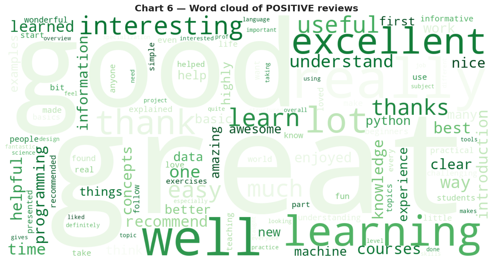
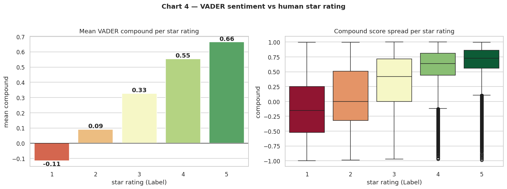
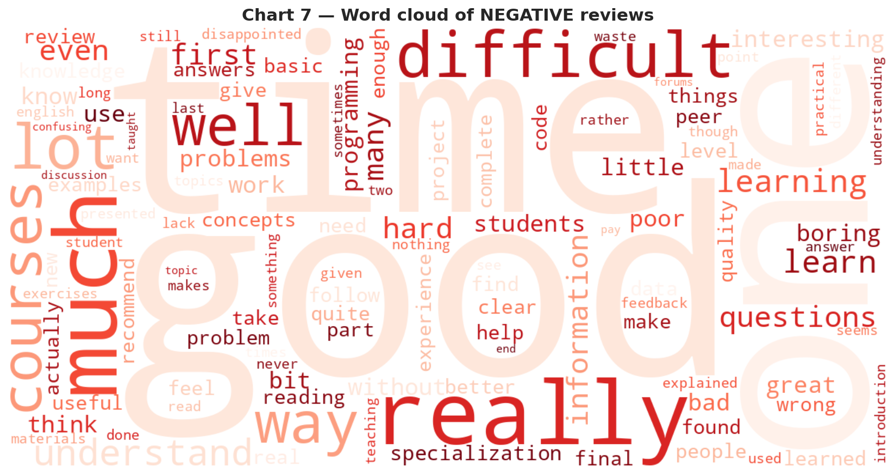
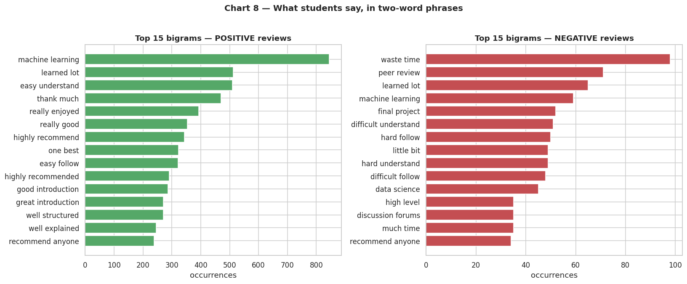

# 💬 Student Feedback Sentiment Analysis

**Mining 107,000 Coursera course reviews with NLP (NLTK VADER) to find what students praise and what frustrates them.**



👤 **Author:** Ahmed Abrar Tahseen · 📅 November 2026 · 🏷️ Project 2 of the GitHub Portfolio Project Pack (Data Science / NLP)

---

## 📌 The problem

Online courses live or die by student feedback. With 100k+ written reviews, reading them one by one is impossible. This project scores every review automatically with **VADER sentiment analysis**, compares machine opinion against the human 1–5 star ratings, and extracts the themes behind praise and complaints — finishing with an **insight memo**.

## 📊 Dataset

[Coursera Course Reviews](https://www.kaggle.com/datasets/roshansharma/coursera-course-reviews) (Kaggle — search *"coursera course reviews"*), scraped from Coursera; downloaded via the public mirror [github.com/sharmaroshan/Coursera-Reviews-Analysis](https://github.com/sharmaroshan/Coursera-Reviews-Analysis) → `data/coursera_course_reviews.csv`.

**107,018 reviews** · columns: `Id`, `Review` (text), `Label` (star rating 1–5).

## 🔧 Method (one paragraph)

Raw reviews are scored with **NLTK VADER** `compound` (range −1…+1; ≥ +0.05 positive, ≤ −0.05 negative) on the *original* text — VADER uses capitalisation and `!!!` as intensity signals, so punctuation is preserved for scoring. A *cleaned* copy (lowercased, URLs/emails/punctuation/digits stripped, whitespace collapsed) is used for token-based visuals: word clouds and bigram counts, with English stop-words plus course-platform nouns (`course`, `lecture`, `video`, …) removed. We then correlate VADER with the star rating, quantify mismatches, and compare VADER with TextBlob on a 500-review sample (stretch).

## 🔑 Key findings (full memo: [`INSIGHTS.md`](INSIGHTS.md))

1. **Ratings are heavily skewed positive** — 74.0% are 5★, 90.9% are 4–5★; only 4.4% are 1–2★ (`figures/01`).
2. **Machine sentiment tracks human stars in aggregate** — Spearman r = 0.27; mean compound rises monotonically 1★→5★ (−0.11 → +0.66) (`figures/04`).
3. **Stars and text disagree on a notable minority** — 938 five-star reviews (1.18%) read negative, 756 one-star reviews (30.62%) read positive; 3★ text averages +0.33, more positive than the middling star implies (`figures/04`, `figures/10`).
4. **What students praise:** *great, excellent, interesting, useful, well explained, easy to follow, highly recommend, well structured* (`figures/06`, `figures/08`).
5. **What frustrates them:** *waste of time, difficult/hard to understand/follow, peer review, final project, boring, poor* — overall split **89.0% positive / 6.3% neutral / 4.7% negative** (`figures/05`, `figures/07`, `figures/08`).

Stretch: VADER vs TextBlob on 500 reviews — polarity correlation r = 0.35, 3-class label agreement **89.6%** (`figures/09`).

## 🖼️ Charts

**Sentiment vs star rating** (machine vs human):



**Negative word cloud**:



**Top bigrams per sentiment class**:



All 10 charts in [`figures/`](figures/), regenerated when the notebook runs.

## ▶️ How to run

```bash
git clone https://github.com/tahseen017/student-feedback-sentiment.git
cd student-feedback-sentiment
pip install -r requirements.txt
python -c "import nltk; nltk.download('vader_lexicon'); nltk.download('stopwords')"
jupyter notebook student_feedback_sentiment.ipynb   # Kernel → Restart & Run All
```

The notebook writes all charts to `figures/` and the memo to `INSIGHTS.md`.

## 🗂️ Project structure

```
student-feedback-sentiment/
├── student_feedback_sentiment.ipynb   # full executed analysis (11 sections + stretch goals)
├── INSIGHTS.md                        # the five-finding insight memo (auto-generated)
├── figures/                           # 10 charts incl. both word clouds
├── data/coursera_course_reviews.csv   # 107,018 reviews (Id, Review, Label)
├── requirements.txt
└── README.md
```

## 💼 CV bullet (once pushed)

> Analysed 107,000 course reviews with NLP sentiment scoring (Python, NLTK VADER) to extract student praise themes and pain points.

## 📄 License

Dataset: as published by the original authors (see mirror repo). Code and analysis: MIT License.
